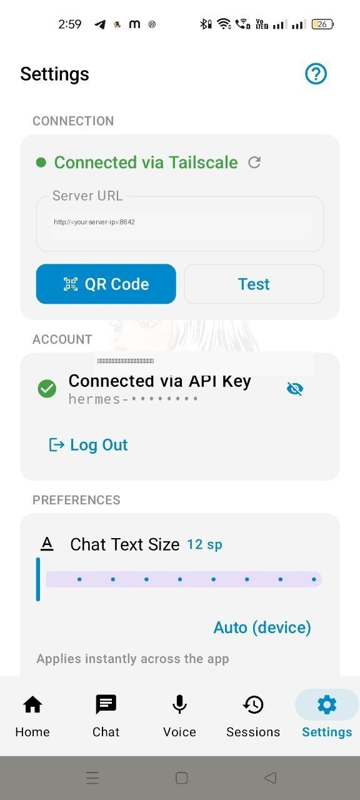

# Hermes Mobile Plugin

<p align="center">
  
  
  
  
  
</p>

The server-side half of **Hermes Mobile**: one plugin that turns your running
[Hermes Agent](https://hermes-agent.nousresearch.com) into a phone-ready hub — QR pairing, voice,
files, and server management. No extra daemon, no cloud relay: everything is mounted on the
gateway you already run (default port **8642**).

> You install **Hermes Agent** from the official site, then this **one plugin**. That's the whole
> server-side setup.

## What you get



*Settings in the app after scanning the QR: server URL + key configured, connection live.*

| Capability | What it means for you |
|---|---|
| **QR pairing** | `install` opens a QR page (URL + API key) in your browser; the app scans it (camera or gallery) and configures + tests the connection itself. |
| **Voice on-device** | Speech-to-text (Whisper) and text-to-speech routes on the gateway, so the phone mic/speaker work with zero extra services. |
| **File transfer** | Upload attachments from the phone, download anything the agent creates — the chat shows real file cards, previewable in-app. |
| **Context meter** | Live token usage / context window per session, straight from server truth. |
| **Slash commands** | The app's `/` menu is built from your actual server commands, not a hardcoded list. |
| **Update from your phone** | About screen checks and applies `hermes update` on the server — restart included. |
| **Keep-awake control** | Toggle the Termux/system wake lock remotely so long runs aren't killed. |
| **24/7 supervisor** | Optional watchdog auto-restarts the gateway if it ever dies, and survives reboots of the app. |
| **Crash reports** | The app pushes its crash dumps here (`~/.hermes/mobile-logs/diag/`) so issues are diagnosable without cables. |
| **Swarm-ready** | Turns started with the app's Swarm toggle carry their own orchestration directives — no extra server setup. |

Nothing is re-implemented: STT/TTS reuse Hermes Agent's own provider chain, sessions/models are
read from the agent's API. The plugin adds routes, not forks.

## Install

**[Download the latest release →](https://github.com/tawaresachin/hermes-mobile-plugin/releases/latest)**
(every release ships a pure-Python `py3-none-any` wheel + sdist with `SHA256SUMS` checksums, built and version-verified by CI)

Into the same Python environment your Hermes Agent runs in (its venv) — Python 3.10 or
newer is required (macOS has no `pip` command; use `python3 -m pip`):

```bash
python3 -m pip install git+https://github.com/tawaresachin/hermes-mobile-plugin@v0.0.37
# or from the release page: pip install hermes_mobile_plugin-<ver>-py3-none-any.whl
hermes-mobile-plugin install   # key + bind host + deploy + enable + runtime env + gateway + QR
hermes plugins list            # must show: hermes-mobile-plugin   enabled
```

`install` enables the plugin in Hermes' registry itself (`hermes plugins enable
hermes-mobile-plugin` — the one command a directory plugin needs, without which every
`/api/mobile/*` route 404s) and seeds `platforms.api_server.extra.host = 0.0.0.0`,
because the gateway otherwise binds `127.0.0.1`, an address the phone cannot dial.
A host you already set is never overridden, so a deliberate loopback install stays
exactly as you left it.

The plugin is pure Python — the one wheel runs unchanged on Windows, macOS, Linux and
Termux (native deps resolve per-OS from PyPI at install time). Not on PyPI; GitHub Releases
is the release channel, which matches how Hermes Agent itself updates from git.

`install` copies the plugin into the Hermes home your agent actually resolves (`~/.hermes` on Linux/Termux, XDG dirs on macOS, `%LOCALAPPDATA%\hermes` on Windows) and (re)starts the gateway.
Then grab the [Hermes Mobile APK](https://github.com/tawaresachin/hermes-mobile/releases), open
**Settings → Connect with QR**, and scan. LAN, Tailscale, or any tunnel — the QR carries the
address your phone can actually reach.

### Where the QR lives

`install` writes the pairing page to
`~/.hermes/plugins/hermes-mobile-plugin/qr_code.html`
(`%LOCALAPPDATA%\hermes\plugins\hermes-mobile-plugin\qr_code.html` on Windows) and **opens it in
your browser** so you can scan it right away. On a headless machine (SSH, server) it prints the
path instead — no text browser is ever launched at a QR nobody can scan.

To see it again, or to regenerate it after the address changed:

```bash
hermes-mobile-plugin qr              # regenerate and open it
hermes-mobile-plugin qr --no-browser # regenerate only, print the path
```

The page embeds your API key, so it is written owner-only (`0600`) — treat it like the key
itself and do not share or screenshot it. A leaked copy is a key-rotation event: `install`
seeds a fresh key when the current one is weak or missing.

## What install sets up automatically

`hermes-mobile-plugin install` is zero-manual: every prerequisite is detected and fixed in
place, and nothing in the user's data is ever clobbered.

| Step | What it does |
|---|---|
| **Validates** config | Surfaces warnings (bad port type, short key) without blocking. |
| **Seeds the API key** | If `platforms.api_server.extra.key` / `API_SERVER_KEY` in `~/.hermes/.env` are missing or < 16 chars, a `secrets.token_urlsafe(48)` key is generated and written to **both** (config with a `.bak` backup, `.env` line replaced/appended, 0600). A strong existing key is kept; a weak line on one side is replaced with the strong one from the other side. `platforms.api_server.extra.host` is seeded to `0.0.0.0` in the same write — the QR advertises a LAN/Tailscale address, which a loopback-bound gateway cannot serve — and a host the user already set is never overridden. |
| **Deploys** the plugin files | Into the Hermes plugins dir, replacing stale copies. The pre-0.0.34 `plugins/hermes-mobile-qr` install is removed in the same step — Hermes keys a directory plugin by its manifest name, so leaving it would register a second plugin whose routes collide. |
| **Enables** the plugin | `hermes plugins enable hermes-mobile-plugin`: a deployed directory plugin is inert until then (every `/api/mobile/*` route 404s), and enabling also hot-loads it in the running gateway. If the launcher cannot be found, the install prints that one command instead of failing. |
| **Installs into the gateway's runtime env** | On hermes-bootstrap hosts (Termux/proot) the gateway runs 3rd-party packages from an isolated venv under `~/.hermes/installs/…/venv`, not the toolchain interpreter — the install detects it (running-gateway pidfile → `/proc/<pid>/exe` → in-process sys.path → newest-mtime scan) and makes it import **this** version: `ensurepip` if needed, `pip uninstall` of any stale installed copy, deps, then a `.pth` to the deployed dir (the same heal `hermes update` runs). "Already has the plugin" is never accepted for an older version. No isolated envs → a one-line notice, install continues. |
| **Generates the QR** | With the (now guaranteed) key baked in; URL/port follow the host's real settings. Opened in your browser at the end of the run (`--no-browser` skips that, headless hosts never try). |
| **Supervises the gateway** | The 24/7 watchdog is ensured **before** any restart. A running gateway is restarted when this install changed something (new key, new bind host, new plugin version — it is still on the old code otherwise) and left untouched when nothing changed. The install then waits up to 60 s for `/health` on the **resolved port** and regenerates the QR. |

Port precedence everywhere (`status`, watchdog, QR): `platforms.api_server.extra.port` →
`API_SERVER_PORT` env → `8642`.

## CLI

```text
hermes-mobile-plugin install      # set up + open the QR page
hermes-mobile-plugin qr           # show/regenerate the QR (--no-browser)
hermes-mobile-plugin status       # supervisor + gateway health
hermes-mobile-plugin supervisor --start|--stop|—daemon 24/7 watchdog
```

## HTTP routes (all Bearer-key protected)

Mounted on the api_server platform; the mobile app is the client.

| Route | Purpose |
|---|---|
| `POST /api/audio/transcribe` · `POST /api/audio/speak` | STT / TTS |
| `POST /api/audio/upload` · `GET /api/audio/download/{sid}/{name}` | attachments both ways |
| `GET /api/mobile/file` | fetch agent-created files for MEDIA cards |
| `GET /api/mobile/commands` · `POST /api/mobile/command/resolve` | slash-command menu |
| `GET /api/mobile/context-usage` · `GET /api/mobile/context-window` | context meter |
| `GET /api/mobile/update/check` · `POST /update/apply` · `GET /update/version` | server self-update |
| `GET /api/system/status` · `POST /api/system/awake` | host status, keep-awake |
| `POST /api/diag/log` · `GET /api/audio/health` | crash reports, liveness |

## Cross-platform

Runs wherever Hermes Agent runs — **Windows, macOS, Linux, Termux/Android** — with per-platform
handling for process detachment, single-instance locks, launcher lookup (`hermes.exe` included),
and keep-awake (termux-wake-lock / caffeine / powershell), degrading honestly when a mechanism
doesn't exist. 53 tests cover the platform seams and the scripted-install paths.

**Termux note:** the shell installer skips pip there (it can trigger NDK toolchain builds);
Hermes Agent's own Termux environment must provide `pyyaml`, `qrcode` and `aiohttp` — the
standard agent install does.

## Development

```bash
git clone https://github.com/tawaresachin/hermes-mobile-plugin.git
cd hermes-mobile-plugin
pip install -e ".[dev]"
PYTHONPATH=src pytest            # 53 tests
```

CI (`.github/workflows/ci.yml`) runs the suite on ubuntu/macos/windows on every push, plus
sandboxed end-to-end dry-runs of `install.sh` (Linux + macOS, including the Termux skip-pip
path) and `install.bat` (Windows, fake venv + redirected home). Version tags additionally
build the wheel, verify the bundled manifest matches the tag, and attach it to the release.

Releases are tagged `v<version>`; `plugin.yaml` is the single source of the version string
(`PLUGIN_VERSION` derives from it — packaging metadata can't drift).

## License

MIT © 2026 Sachin Taware
